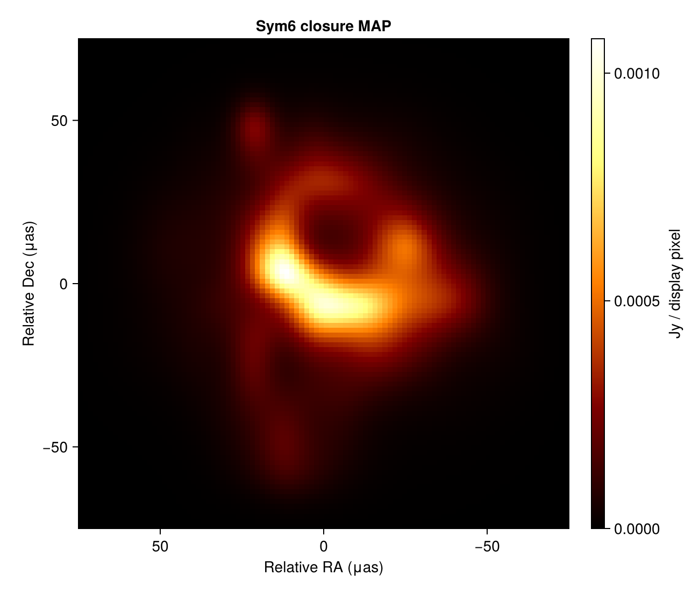

# Closure imaging with Comrade

This example uses a wavelet prior to fit closure phases and amplitudes with
[Comrade.jl](https://ptiede.github.io/Comrade.jl/). Weighted independent
Laplace(0, 1) coefficients are synthesized with a periodic Sym6 wavelet and
applied multiplicatively to a normalized mean image; an extended Gaussian
component is added. The prior is evaluated on the unweighted coefficients.

## Sym6 reconstruction



This exploratory MAP image in transformed coordinates uses EHT 2017 M87 Stokes I observations, with
scan-averaged closure quantities and 2% noise inflation. The inference grid is
32×32 over 150 μas; the image above evaluates the fitted model on a 100×100
display grid. The model fixes unit total flux; closure data alone constrain
neither total flux nor absolute position. The run reached 10,000 iterations without converging; it is not a
posterior uncertainty estimate.

To rerun these settings, obtain `SR1_M87_2017_096_lo_hops_netcal_StokesI.uvfits` from the
[Comrade closure-imaging tutorial](https://ptiede.github.io/Comrade.jl/stable/tutorials/intermediate/ClosureImaging)
(SHA-256 `f3394b2c272ba92980c21e3522987344f9175a78c333648a36458c917216c365`),
then run from the repository root. Package versions can affect the result:

```sh
cd examples/comrade_wavelet
julia --project=. -e 'using Pkg; Pkg.develop(path="../.."); Pkg.instantiate()'
WAVELET_SEED=20261031 WAVELET_NPIX=32 \
  WAVELET_MAXITERS=10000 WAVELET_UVFITS=/path/to/m87.uvfits \
  WAVELET_OUTPUT=/tmp/sym6 julia --project=. closure_imaging.jl
julia --project=. plot_reconstruction.jl /tmp/sym6/wavelet_closure_map_display100.fits
```
